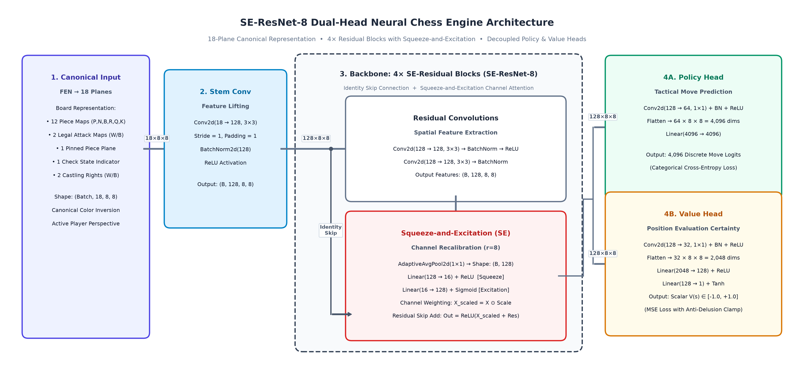

# SE-ResNet-8: Dual-Head Deep Residual Neural Network with Squeeze-and-Excitation Attention for Chess Policy & Value Prediction

[](https://pytorch.org/)
[](https://onnx.ai/)
[](https://python.org/)
[](README.md)

---

## Academic Credentials & Notice

- **Student Author:** P Meenun Reddy
- **Roll Number:** NC.SC.U4CSE24029
- **Department:** Computer Science and Engineering (CSE - A)
- **Year / Semester:** 3rd Year
- **Course:** Neural Networks and Deep Learning (ML Model Building Project)

> [!CAUTION]
> **Academic Integrity & Copyright Notice:**
> This repository contains the original machine learning model architecture, training pipeline, and dataset engineering created by **P Meenun Reddy** for the *Neural Networks and Deep Learning* course evaluation. Unauthorized copying, plagiarism, duplication, or redistribution of this model code, architecture, or trained weights is strictly prohibited.

---

## 1. Project Abstract

Standard convolutional neural networks applied to chess board evaluation struggle to balance global tactical spatial reasoning (e.g., long-range bishop diagonals, pinned pieces, and king exposure) with localized piece interactions. 

**SE-ResNet-8** is a custom deep convolutional neural network featuring:
1. **18-Plane Canonical Spatial Board Representation**: Encodes piece positions, legal attack maps, pins, check indicators, and castling rights from the active player's forward-facing perspective.
2. **Squeeze-and-Excitation (SE) Channel Attention**: Dynamically recalibrates feature map channels by modeling inter-channel dependencies through adaptive global pooling and non-linear gating bottlenecks ($r=8$).
3. **Decoupled Dual-Head Architecture**:
   - **Policy Head**: Predicts discrete move probability distributions across the full $4,096$-dimensional origin-destination action space ($64 \times 64$).
   - **Value Head**: Estimates position win certainty $V(s) \in [-1.0, +1.0]$ via a non-linear scalar projection with Tanh activation.

---

## 2. Neural Architecture



### Architectural Specifications

| Component | Layer Specification | Output Dimensions | Parameters |
| :--- | :--- | :--- | :--- |
| **Input Tensor** | Canonical 18-Plane Spatial Encoding | $(B, 18, 8, 8)$ | - |
| **Stem Convolution** | Conv2d(18 $\to$ 128, $3 \times 3$, pad 1) + BN + ReLU | $(B, 128, 8, 8)$ | 21,000 |
| **Backbone (4× Blocks)** | 4× Residual Blocks with Squeeze-and-Excitation | $(B, 128, 8, 8)$ | 1,188,864 |
| **Policy Head** | Conv2d(128 $\to$ 64, $1 \times 1$) + BN + ReLU + FC($4096 \to 4096$) | $(B, 4096)$ | 16,785,472 |
| **Value Head** | Conv2d(128 $\to$ 32, $1 \times 1$) + BN + ReLU + FC($2048 \to 128$) + FC($128 \to 1$) | $(B, 1)$ | 266,657 |
| **Total Trainable** | Full Dual-Head SE-ResNet-8 Model | - | **~18,261,993** |

---

## 3. Mathematical Formulation

### 3.1 Squeeze-and-Excitation Channel Attention
For any intermediate convolutional feature map $\mathbf{X} \in \mathbb{R}^{C \times H \times W}$ with $C=128$ and $H=W=8$:

1. **Squeeze Step (Global Average Pooling):**
   $$z_c = \mathbf{F}_{sq}(\mathbf{u}_c) = \frac{1}{H \times W} \sum_{i=1}^{H} \sum_{j=1}^{W} u_c(i, j), \quad \mathbf{z} \in \mathbb{R}^{C}$$

2. **Excitation Step (Two-Layer Bottleneck with Reduction Ratio $r=8$):**
   $$\mathbf{s} = \mathbf{F}_{ex}(\mathbf{z}, \mathbf{W}) = \sigma\Big(\mathbf{W}_2 \ \delta(\mathbf{W}_1 \mathbf{z})\Big)$$
   where $\mathbf{W}_1 \in \mathbb{R}^{\frac{C}{r} \times C} = \mathbb{R}^{16 \times 128}$, $\mathbf{W}_2 \in \mathbb{R}^{C \times \frac{C}{r}} = \mathbb{R}^{128 \times 16}$, $\delta$ is the ReLU activation, and $\sigma$ is the Sigmoid gating function.

3. **Feature Recalibration & Residual Connection:**
   $$\widetilde{\mathbf{x}}_c = s_c \cdot \mathbf{u}_c, \qquad \mathbf{Y} = \text{ReLU}\Big(\widetilde{\mathbf{X}} + \mathbf{X}_{\text{residual}}\Big)$$

### 3.2 Multi-Task Composite Loss Function
The model is optimized end-to-end using a joint multi-task objective:
$$\mathcal{L}_{\text{total}}(\theta) = \mathcal{L}_{\text{policy}}(\mathbf{p}, \mathbf{y}_{\text{move}}) + \lambda \mathcal{L}_{\text{value}}(v, y_{\text{val}})$$

- **Policy Loss:** Categorical Cross-Entropy over $4,096$ move classes:
  $$\mathcal{L}_{\text{policy}} = -\sum_{i=1}^{4096} y_{\text{move}, i} \log(p_i)$$
- **Value Loss:** Mean Squared Error (MSE) between scalar prediction and ground-truth tactical outcome:
  $$\mathcal{L}_{\text{value}} = \frac{1}{B} \sum_{k=1}^{B} (v_k - y_{\text{val}, k})^2$$
  with loss weighting factor $\lambda = 0.5$.

---

## 4. 18-Plane Canonical Board Representation

Each chess position is mapped into an 18-channel $8 \times 8$ bitboard tensor:
- **Channels 0–5:** Active player's pieces $[P, N, B, R, Q, K]$
- **Channels 6–11:** Opponent's pieces $[p, n, b, r, q, k]$
- **Channel 12:** Active player legal attack influence map
- **Channel 13:** Opponent legal attack influence map
- **Channel 14:** Absolute pinned piece spatial plane
- **Channel 15:** In-check indicator plane (broadcast $1$s or $0$s)
- **Channel 16:** Active player castling rights (kingside / queenside quadrants)
- **Channel 17:** Opponent castling rights (kingside / queenside quadrants)

**Canonical Perspective Inversion:** If Black is to move, the board is mirrored along ranks ($y \mapsto 7 - y$) and piece colors are inverted. Thus, the neural network *always* solves positions from the perspective of White pushing forward.

---

## 5. Repository Structure

```
ML-miniproject/
├── ml/
│   ├── dataset.py                # 18-Plane Canonical Board Encoding & PyTorch Dataset
│   ├── train.py                  # SE-ResNet-8 Model Architecture & Training Loop
│   ├── download_data.py          # Lichess tactical dataset download pipeline
│   ├── mine_blunders.py          # Tactical blunder mining for curriculum learning
│   ├── harvest_opening_concepts.py # Tactical motif harvesting script
│   └── harvest_sacrifices.py     # Sound sacrifice mining
├── weights/
│   ├── chess_mate_cnn.pt         # Trained PyTorch model checkpoint (~70 MB)
│   ├── chess_mate_cnn.onnx       # Exported ONNX graph (cross-platform deployment)
│   └── chess_mate_cnn.onnx.data  # ONNX tensor weights (~70 MB)
├── data/
│   ├── se_resnet8_architecture.png # 300 DPI high-res architecture diagram
│   └── books/                    # Polyglot opening theory weights
│       ├── performance.bin
│       └── titans.bin
├── inference.py                  # Standalone CLI inference & FEN evaluation tool
├── evaluate.py                   # Benchmark & accuracy evaluation script
├── generate_arch_diagram.py      # Reproducible architecture diagram generator
├── generate_report.py            # Academic report compiler (FPDF2)
├── SE_ResNet8_Chess_Engine_Project_Report.pdf # 10-Page Course Project Report
├── requirements.txt              # Pure machine learning dependencies
└── README.md                     # Project documentation
```

---

## 6. Quickstart: Installation & Inference

### 6.1 Environment Setup
```bash
# Clone the repository
git clone https://github.com/Meenun-123/ML-miniproject.git
cd ML-miniproject

# Create virtual environment
python3 -m venv .venv
source .venv/bin/activate

# Install pure ML requirements
pip install -r requirements.txt
```

### 6.2 Running Model Inference
Evaluate any chess board position (in FEN notation) to inspect the value score and top-5 predicted moves:

```bash
# Evaluate an Italian Game position with PyTorch
python inference.py --fen "r1bqk2r/pppp1ppp/2n2n2/2b1p3/2B1P3/3P1N2/PPP2PPP/RNBQK2R w KQkq - 1 5"

# Or run using ONNX Runtime
python inference.py --onnx --fen "r1bqkb1r/pppp1ppp/2n5/4p3/2B1n3/5Q2/PPPP1PPP/RNB1K1NR w KQkq - 0 4"
```

**Sample Output:**
```
=================================================================
     SE-ResNet-8 Dual-Head Neural Chess Engine Inference
     Architecture: 4× SE-ResBlock (128 ch) | 18-Plane Input
=================================================================

FEN: r1bqk2r/pppp1ppp/2n2n2/2b1p3/2B1P3/3P1N2/PPP2PPP/RNBQK2R w KQkq - 1 5
Active Player to Move: White

      a   b   c   d   e   f   g   h
    +-------------------------------+
  8 | r | . | b | q | k | . | . | r | 8
  7 | p | p | p | p | . | p | p | p | 7
  6 | . | . | n | . | . | n | . | . | 6
  5 | . | . | b | . | p | . | . | . | 5
  4 | . | . | B | . | P | . | . | . | 4
  3 | . | . | . | P | . | N | . | . | 3
  2 | P | P | P | . | . | P | P | P | 2
  1 | R | N | B | Q | K | . | . | R | 1
    +-------------------------------+
      a   b   c   d   e   f   g   h

-----------------------------------------------------------------
 POSITION EVALUATION (Value Head)
-----------------------------------------------------------------
  • Scalar Value V(s):       +1.0000  (in range [-1.0, +1.0])
  • Active Win Probability:  100.00%
  • Positional Assessment:   Decisive advantage for White

-----------------------------------------------------------------
 CANDIDATE MOVE PREDICTIONS (Policy Head - Top 5)
-----------------------------------------------------------------
  Rank  SAN      UCI      Probability    Confidence Bar
  ---- ------- ------- ------------- --------------------
  #1    Bb3      c4b3       7.44%       ██
  #2    Rg1      h1g1       6.99%       ██
  #3    c3       c2c3       4.73%       █
  #4    Rf1      h1f1       4.58%       █
  #5    Ke2      e1e2       4.51%       █
-----------------------------------------------------------------
```

### 6.3 Interactive CLI Match
Play directly against the trained SE-ResNet-8 neural engine in your terminal:

```bash
# Play as White against SE-ResNet-8 (PyTorch)
python inference.py -i

# Play as Black using lightweight ONNX Runtime
python inference.py --onnx -i --play_as black
```

### 6.4 Evaluating Model Accuracy & Latency
Run the evaluation benchmark across both backends (measures Top-1/3/5 accuracy, inference latency, and throughput):

```bash
# Evaluate with PyTorch
python evaluate.py

# Evaluate with ONNX Runtime
python evaluate.py --onnx
```

### 6.5 Compiling Academic Artifacts
Regenerate high-resolution architecture diagrams and the 10-page academic report PDF:

```bash
# Generate 300 DPI architecture diagram
python generate_arch_diagram.py

# Compile IEEE-style 10-page course project report
python generate_report.py
```

### 6.6 Training from Scratch
To train the SE-ResNet-8 model on tactical datasets with learning rate warm-restarts:
```bash
python ml/train.py \
    --data_path data/mate_puzzles.csv \
    --epochs 20 \
    --batch_size 128 \
    --lr 2e-3 \
    --num_blocks 4 \
    --channels 128 \
    --scheduler cosine_restarts \
    --restart_epochs 5
```

---

## 7. Model Checkpoints & Artifacts

- **PyTorch Model Checkpoint:** [`weights/chess_mate_cnn.pt`](weights/chess_mate_cnn.pt)
- **ONNX Computation Graph:** [`weights/chess_mate_cnn.onnx`](weights/chess_mate_cnn.onnx)
- **Project Report (10 Pages, IEEE style):** [`SE_ResNet8_Chess_Engine_Project_Report.pdf`](SE_ResNet8_Chess_Engine_Project_Report.pdf)
- **High-Resolution Architecture Diagram:** [`data/se_resnet8_architecture.png`](data/se_resnet8_architecture.png)

---

## 8. License & Academic Disclaimer

Copyright &copy; 2026 **P Meenun Reddy**. All Rights Reserved.  
Submitted in partial fulfillment of the requirements for the course **Neural Networks and Deep Learning**, Department of Computer Science and Engineering.
